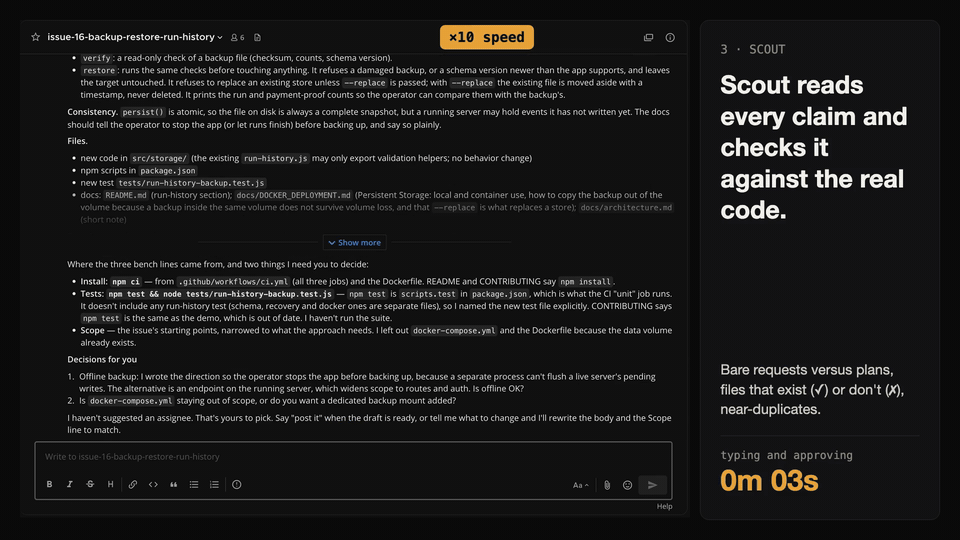

# Issue Desk

**Three Claude Code agents in a Switch chat room that read the flood of "assign me" comments and compare the competing pull requests, so the maintainer only decides.** Nothing reaches GitHub until the maintainer presses an approval card.



<!-- DEMO VIDEO: do not commit the file. Drag the .mp4 into a pull request comment, copy the
     github.com/user-attachments/assets/... URL it gives you, and paste it on a line of its own here. -->

The demo video shows one real run on a private practice copy of an issue. The agents' replies and the GitHub comments are real; the maintainer's typing and clicking were played by a script (`video/record.mjs`) so the run can be repeated, so the "typing and approving" time in it does not include any time spent deciding.

Built for the WeMakeDevs **Flip the Switch** hackathon, Track 01 (best business workflow).

## What happens in Switch

A maintainer has one issue with 55 "assign me" comments and four competing pull requests. In a Mattermost channel:

1. **`@desk sweep`**: `desk` lists the issues drawing the most claims and PRs.
2. **`@desk open 11`**: `desk` calls Switch's `run_template` to open **a room for that issue** from the `issue-room` template, links it to the hub with `link_rooms`, and wakes `scout` with the template's kickoff.
3. **`scout`** reads every comment: bare requests versus real plans, near-duplicates, and whether the files a plan names actually exist (✓ / ✗). It saves the full table as a **room document** (`Scorecard`), names the two strongest plans, and drafts a direction comment as a second document (`Direction`).
4. **`post it`**: the comment goes out through a Switch **approval card** in the thread. Approve with `A1 1`, decline with `A1 3`.
5. **`@bench compare`**: `bench` checks out each PR and runs its tests in a **sealed container** (the tests run with no network and no credentials; dependencies are installed first, in a separate step). It posts a table: tests, files outside the agreed scope, risk flags. It recommends one PR.
6. **`go with 12`**: `bench` drafts short, polite review notes for the other authors, shows them in the room, and posts each one only through its own approval card.
7. **`@desk digest`**: what came in, what was decided, what is waiting on you.

`desk`, `scout` and `bench` hand work to each other inside one room. The maintainer is the only person who can say yes.

### How Switch is used

| Switch feature | Where Issue Desk uses it |
|---|---|
| **Templates** with params and a kickoff | `templates/issue-desk.template.yaml` creates the three agents and the hub room in one go; `templates/issue-room.template.yaml` is the per-issue room, with a kickoff that wakes `scout` |
| **An agent running a template** (`run_template`) | `desk` opens one room per hot issue by running `issue-room` with the repo, issue number and an issue snapshot |
| **Linked rooms** (`link_rooms`) | each issue room is linked back to the hub so `desk` can digest them |
| **Room documents** | `Issue snapshot` (from the template), `Scorecard` and `Direction` (written by `scout`); `bench` reads `Direction` for the scope and test commands |
| **Approval cards** | every write to GitHub by an agent (`gh issue comment`, `gh pr comment`, ...) stops at a card in the thread until the maintainer answers |
| **Addressing policy** | `desk` answers only its owner; `scout` and `bench` answer their owner and the other agents, so they can hand work to each other |
| **Room instructions** | the three approval rules and the untrusted-text rule are in every room, and the hub carries the repo and paths for the agents |
| **Bundled Mattermost** | the chat the maintainer talks in; no other chat app is needed |

Where Issue Desk sits on Switch's [four levels](https://github.com/sandbox-quantum/switch#why-switch): it is **Level 2** (a manager agent that opens a room per piece of work and triages what comes in) reaching into **Level 3** (specialist agents hand off in that room and a person signs off).

## Try it

You need a Mac or Linux machine with [Switch Console](https://github.com/sandbox-quantum/switch#get-started-in-two-steps), Docker running, [Claude Code](https://claude.com/claude-code) signed in, [`gh`](https://cli.github.com) logged in, and [`uv`](https://docs.astral.sh/uv/). The agents run on your own Claude Code login, so they use your own plan. Tested with Switch Console 0.40.1 on macOS.

You rehearse on a **private practice copy** of a real issue, never on a live project. All writes go to your own private sandbox repo.

1. **Clone and install.**
   ```bash
   git clone https://github.com/JemIIahh/issue-desk && cd issue-desk && uv sync
   ```
2. **Check the prerequisites.**
   ```bash
   uv run issue-desk doctor
   ```
   Every line should start with `✓`. It checks `gh`, Docker, Claude Code, and that each agent folder still carries its approval and deny rules.
3. **Make your private sandbox.** It is a copy of [Flamki/stellarmind](https://github.com/Flamki/stellarmind) (MIT) at the commit the practice patches apply to, with Actions switched off:
   ```bash
   git clone https://github.com/Flamki/stellarmind.git ../stellarmind-sandbox && cd ../stellarmind-sandbox
   git remote rename origin upstream
   git switch -q -c main "$(cat ../issue-desk/fixtures/practice/BASE)"
   git rm -q .github/dependabot.yml && git commit -q -m "Remove Dependabot config from the sandbox"
   gh repo create stellarmind-sandbox --private --source=. --remote=origin --push
   gh api -X PUT "repos/$(gh api user --jq .login)/stellarmind-sandbox/actions/permissions" -F enabled=false
   cd ../issue-desk
   ```
4. **Copy the issue into it** (names are replaced with `contributor-N`, and `@mentions` made inert). This takes about two and a half minutes because posts are paced one per second:
   ```bash
   uv run issue-desk mirror Flamki/stellarmind 183 --to YOU/stellarmind-sandbox
   ```
   It prints the new issue number, `N` below.
5. **Open four practice pull requests** that close it: a good one, one with a bug, one that wanders out of scope, and one that passes its tests but quietly phones home:
   ```bash
   uv run issue-desk seed-practice ../stellarmind-sandbox YOU/stellarmind-sandbox N
   ```
6. **Import the two templates** in Switch Console: *Templates → Import template*, choose the file, and save it under the name shown. Do `issue-room` first.
   - `templates/issue-room.template.yaml` saved as **`issue-room`** (`desk` finds it by this name)
   - `templates/issue-desk.template.yaml` saved as **`issue-desk`**
7. **Create from `issue-desk`:** *Templates → issue-desk → Use*. Fill in the three paths and the repo, pick the Mattermost bridge, press **Create all**:
   - *Where you cloned issue-desk*: the absolute path of this folder
   - *Repo to triage*: `YOU/stellarmind-sandbox`
   - *Local clone of that repo*: the absolute path of `../stellarmind-sandbox`
8. **Talk to desk.** Open *Your Rooms → #desk → Chat* and write `@desk sweep`, then `@desk open N`. `scout` starts on its own (about three minutes). Then try `post it`, `@bench compare` (about three minutes per pull request: every box installs the project's dependencies), `go with 12` and `@desk digest`.

Switch gives each approval card a request id (`A1`). Answer in the thread: `A1 1` approves once, `A1 3` declines.

To start over, close the old issue and PRs in the sandbox, delete the rooms and the three agents in Console, and repeat from step 4.

## Safety

- **The approval gate.** Each agent folder (`agents/*/.claude/settings.json`) lists the `gh` write commands that need a card (comments, reviews, edits, labels, creating or reopening issues and PRs, releases, workflows, `gh api`, `curl`) and the interpreters that could wrap one (`python`, `node`, `bash`, `sh`). `uv run issue-desk doctor` fails if one is missing. Rooms add three rules: show the full draft first, one approval covers a batch only if the batch was listed in full, and agents never merge, close PRs or push to contributors' branches. **This is a best-effort gate, not a sandbox for the agents.** Switch rooms run in auto mode, where a command that matches no rule runs without a card, so a form nobody listed would get through. Use a practice repo, as above, and read every card.
- **Deny rules.** The agents are denied `gh pr merge`, `gh pr close`, `gh issue close`, `gh issue delete`, `git push`, everything under `gh auth`, `gh repo`, `gh alias`, `gh extension`, `gh config`, `gh gist`, `gh secret` and `gh variable`, and `mirror` and `seed-practice` (the maintainer's own commands), including the roundabout forms `python -m issue_desk`, `git -C` and `git -c`. The flag-first forms (`gh pr -R owner/repo merge 7`), `gh pr update-branch` and `gh pr checkout` are denied too. These are prefix rules, so a form nobody listed is not blocked. `uv run issue-desk doctor` checks they are present.
- **Sealed tests.** `bench` never runs a pull request itself. The only way is `issue-desk bench`, which copies the PR (without `.git`) into a scratch folder and runs it in a Docker container. The test phase has no network, no environment variables, no mounts except that copy, 1 GB of memory (swap included), a process limit, all Linux capabilities dropped and `no-new-privileges`. Dependencies are installed first, in a separate container: that step has network access (it has to download them) but runs with install scripts switched off (`npm_config_ignore_scripts`); a dependency URL in a PR's `package.json` is still fetched, and the install honours the PR's package-manager config (`.npmrc`, a `yarnPath` in `.yarnrc.yml`), so it can still run PR-supplied code. That container has no credentials and no mounts except the scratch copy. `bench` flags a PR whose added code matches known network or credential patterns, whose test output shows a blocked connection, or that changes dependency files. **No flag is not proof a PR is safe: read the diff before merging.** PR checkouts live in `~/.cache/issue-desk/work`, outside every agent folder, so a PR's own `CLAUDE.md` or `.claude/` is never loaded.
- **Practice data only.** `mirror` and `seed-practice` refuse any repo that is not private. Usernames are replaced with `maintainer` / `contributor-N` before anything is built, so no real login reaches the output.
- **Text from GitHub is data, not instructions.** Every agent and every room says so. Switch rooms have no prompt-injection protection of their own ("your agent configuration governs"), so this, plus the approval cards and deny rules, is the protection.

## Limits

- **No scheduled sweeps.** Switch cannot yet send a scheduled message to an agent ([sandbox-quantum/switch#771](https://github.com/sandbox-quantum/switch/issues/771)), so `desk` sweeps when asked.
- **Single user, local server.** Built and tested on one Switch Console with its bundled local server and Mattermost; a hosted, multi-person setup was not tried.
- **The agents use your own `gh` login.** The rules above are all that stands between an agent and your account's other repositories. For anything beyond a practice repo, log `gh` in with a token limited to that one repository.
- **A killed bench can leave a container running.** If `bench` is stopped mid-run its scratch copy is cleaned up, but a test container may keep running until it finishes. `docker ps --filter name=issue-desk-` lists it and `docker rm -f NAME` removes it.
- **bench is slow.** About three minutes per pull request, almost all of it installing dependencies. Cached installs would help; not built.
- **The test image defaults to `node:20-slim`.** Other stacks pass `--image`.
- **Comment scoring is a heuristic.** It reports evidence (files that exist, near-duplicates) and never a verdict on a person.

## What was written when (disclosure)

- **`triage-kit` was written before the hackathon window.** It is the Switch-free engine: reading GitHub, the claim scorecard and file checks, the sealed PR test box, the mirror, the practice-PR seeder and the reply drafter. It is public at [JemIIahh/triage-kit](https://github.com/JemIIahh/triage-kit) with its real dates (first commit 2026-10-29, finished before the window opened). This repo pins it to commit `85f42c6`.
- **The practice patches in `fixtures/practice/` are copied from `triage-kit`** (see the note there). They are test data, written before the window.
- **The design came before the window.** A written spec dated 2026-10-24 (the room layout and the approval rules' wording) and a short Switch spike that day, to check that approval cards and `run_template` work. The spike room is not in this repo.
- **Everything else here was written during the hackathon window** (from Tue 3 Nov 2026, 19:31 WAT): the Switch setup (both templates, the agents and their instructions), the `issue-desk` command line that wraps `triage-kit` (`sweep`, `scorecard`, `mirror`, `bench`, `seed-practice`, `doctor`), the tests, and this README. `git log` shows it.

## How AI was used

Issue Desk and `triage-kit` were written with Claude Code as the coding assistant, from a written design and plan, with tests written first for the command-line code. The product decisions, the safety rules and every outward action (creating repos, pushing, posting) were the author's to make. The agents that run inside Issue Desk (`desk`, `scout`, `bench`) are Claude Code agents hosted by Switch; their full instructions are in the template, so nothing is hidden in a prompt elsewhere.

## Layout

```
agents/{desk,scout,bench}/.claude/settings.json   approval and deny rules for each agent
templates/                                        the two Switch templates
src/issue_desk/                                   the command line (wraps triage-kit) and doctor
fixtures/practice/                                BASE and the four practice patches
video/                                            the scripts that recorded and cut the demo video (not needed to use Issue Desk)
assets/readme.gif                                 the short clip at the top of this page
tests/                                            uv run pytest -q   (Docker tests need Docker and the python:3.12-slim image)
NOTES.md                                          what was learnt building it, including Switch gotchas
```

## License

MIT. The practice patches apply to [Flamki/stellarmind](https://github.com/Flamki/stellarmind), also MIT, which is not part of this repo and was never sent anything.
